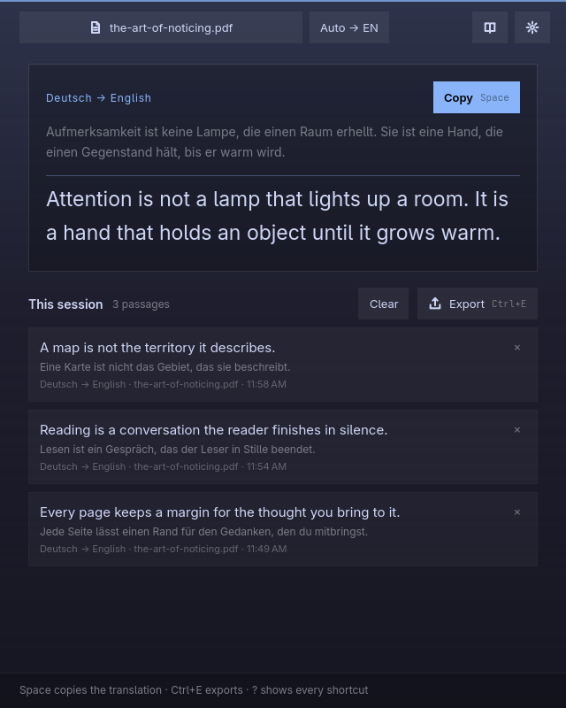
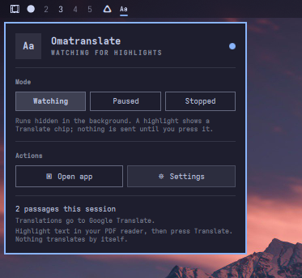

# Omatranslate

Translate the passage you highlight in a PDF, right where you are reading —
then keep the session as Markdown.



Omatranslate is a reading companion for [Omarchy](https://omarchy.org). It
watches the Wayland primary selection while you read in your own PDF reader.
Highlight a passage and a small **Translate** chip appears next to it. Nothing
is sent anywhere until you press that chip: the highlight is an offer, not a
command. The translation opens in a card over the page, and every passage you
translate gathers in the app's window, ready to export as a sidecar Markdown
file when you are done.

The PDF is opened in your reader and is never modified. Translations live in
memory for one session and are written only when you export them.

## Why it feels different

- **You decide when.** Highlighting never translates by itself. The chip, the
  Enter key, and `omatranslate translate` are the only things that send text.
- **Your reader stays yours.** Omatranslate opens the PDF through `xdg-open`,
  so Okular, Evince, Zathura, or whatever you already use keeps the keyboard
  and its own shortcuts.
- **One quiet background process.** Start it from the Omarchy bar and it waits
  hidden. The window opens only when you ask for it, and closing the window
  puts it back in the background instead of ending the session.
- **Your translation service.** Google Translate works with no account, or use
  your own DeepL key or a LibreTranslate server you run yourself.
- **Nothing kept behind your back.** History is session-only, and the exact
  endpoint and what is sent to it are spelled out in Settings.

## Install

Omarchy provides every dependency. From a terminal:

```sh
git clone https://github.com/kartabas/omatranslate omatranslate
cd omatranslate
./bin/install
```

`bin/install` builds the app, installs the package with `makepkg`, and adds the
Omatranslate widget to the bar. The app then appears in the launcher
(`Super + Space`) and in the **Open with** menu for PDFs. It does not take over
as your default PDF reader.

If the app is already installed, refresh only the bar widget with:

```sh
omatranslate plugin install
omatranslate plugin remove   # take it out again
```

Both leave every other bar widget where it was.

## Update

```
omarchy plugin update kartabas.omatranslate
```

## Uninstall

```
omarchy plugin remove kartabas.omatranslate
```


## Read a PDF

1. Open a PDF from your reader as usual, from the **Open with** menu, or with
   `omatranslate open paper.pdf`.
2. Highlight a passage. A **Translate** chip appears where the selection ended
   and stays for a second; click it while it is there, or press `Enter` in the
   Omatranslate window.
3. The translation opens in a card beside the passage, with **Copy** and
   **Close**. Your reader keeps the keyboard the whole time.
4. Press `Ctrl+E` (or **Export**) to write `paper.omatranslate.md` beside the
   PDF. The original file is untouched.

The card sits where the highlight ended rather than scrolling with the page. It
needs Hyprland to know where that is; without it, the translation still appears
in the app window.

## The bar widget

The widget is the on/off switch and the window's front door. It has three
modes and two actions:



| Control | What happens |
| --- | --- |
| **Watching** | Starts the hidden service. A highlight shows the Translate chip. |
| **Paused** | Stops watching and hides the chip, but keeps the session in memory. |
| **Stopped** | Ends the process, unless the session still has unexported translations. |
| **Open app** | Shows the window. Closing it hides the window and keeps watching. |
| **Settings** | Opens straight to the translation service and language choices. |

The same switches work from a terminal:

```sh
omatranslate enable            # start watching in the background
omatranslate disable           # pause, keeping the session open
omatranslate stop              # pause and quit, unless a session needs exporting
omatranslate open              # show the window (starting the service if needed)
omatranslate hide              # put the window away, keep watching
omatranslate status            # what is running, watching, or paused
```

See [The bar widget](docs/bar-widget.md) for installation details, the
`shell.json` entry, and what to do after an update.

## Where translations go

Choose the service in **Settings** (the gear, or `Ctrl+,`). The sheet always
names the exact address, what is sent there, and where credentials live.

| Service | Account or key | Endpoint |
| --- | --- | --- |
| Google Translate | none | `https://clients5.google.com/translate_a/t` |
| DeepL | your API key | `https://api.deepl.com/v2/translate`, or the free host for `:fx` keys |
| LibreTranslate | optional key | the server you name, `/translate` appended |

Only the highlighted passage, the language codes, and — for DeepL and
LibreTranslate — your key leave the machine. The document, its name, and your
reading history are never sent. Keys are stored in
`~/.config/omatranslate/omatranslate.ini`, readable only by you (`0600`).

Full details, including self-hosting LibreTranslate:
[Translation services](docs/translation-services.md).

## Command line

The same binary works without a display, for scripts and coding agents:

```sh
omatranslate translate --to de "The cat sat on the mat."
omatranslate translate --to pt --json "Good morning"
omatranslate translate --from en --to da - < passage.txt
omatranslate languages --json
omatranslate status --json
omatranslate skill install      # teach coding agents how to use it
```

`translate` uses the service selected in Settings, so a script and the window
never disagree about where text is sent. Every command exits 0 on success and
1 on failure, with the error on stderr.

Full reference: [Command line](docs/cli.md).

## Documentation

| Guide | What it covers |
| --- | --- |
| [Reading and the session](docs/usage.md) | The chip, the card, history, export, and every keyboard shortcut |
| [The bar widget](docs/bar-widget.md) | Modes, install and removal, the `shell.json` entry, updates |
| [Translation services](docs/translation-services.md) | Endpoints, privacy, keys, self-hosted LibreTranslate |
| [Command line](docs/cli.md) | Every command, option, and JSON field |
| [Architecture](docs/architecture.md) | The single process, the control socket, the overlay, the data model |
| [Development](docs/development.md) | Build, test, layout, adding a provider or a language |
| [Troubleshooting](docs/troubleshooting.md) | When the chip, the card, or the widget does not appear |

## Requirements

Omarchy already includes these: `qt6-base`, `qt6-declarative`, `qt6-wayland`,
`qt6-svg`, `layer-shell-qt`, `xdg-desktop-portal`, `wl-clipboard`,
`xdg-utils`. Building also needs `gcc` and `make`.

Omatranslate targets Wayland sessions. Hyprland is needed only for placing the
card next to the highlight.

## Development

```sh
./bin/build     # qmake6 + make into build/omatranslate
./bin/test      # Qt Test offscreen, plus the command-line checks
./bin/install   # build, package, install, and add the bar widget
```

See [Development](docs/development.md) for the project layout and how to add a
translation provider or an interface language.

## License

MIT. Parts of the theme, translator, and portal file picker follow Omacut,
Signed, and Monologue by David Heinemeier Hansson, also MIT.
