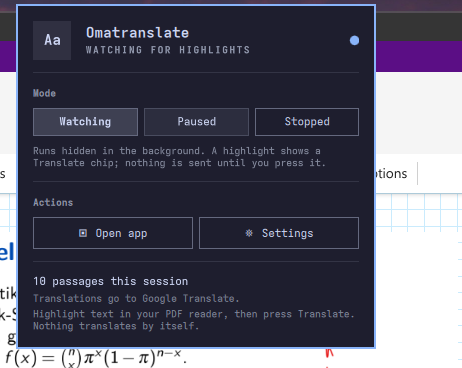

# The bar widget

The Omatranslate widget lives in the Omarchy bar. It starts and stops the
background service, shows whether it is watching, and opens the app window on
demand.



## Installing and removing

`./bin/install` installs the package and the widget. If the app is already
installed:

```sh
omatranslate plugin install    # add or refresh the widget
omatranslate plugin remove     # take it out again
omatranslate plugin --json     # report whether it is installed
```

The widget is a normal Omarchy user plugin. `plugin install` writes it to

```
~/.config/omarchy/plugins/kartabas.omatranslate/
├── Panel.qml
├── manifest.json
└── i18n/{en,de,da}.json
```

and adds one entry to `~/.config/omarchy/shell.json`, in
`bar.layout.centerEnd`:

```json
{ "id": "kartabas.omatranslate", "enabled": true }
```

`plugin remove` deletes that entry and the folder, and leaves every other bar
widget untouched. Move the entry to another section with the bar's own
settings if you prefer it elsewhere.

The `enabled` flag is the widget's memory: after the bar starts, an enabled
widget asks the service to watch again. It is not a second copy of the app's
own `enabled` setting; the app is the source of truth and the widget follows
`omatranslate status --json`.

## Modes

| Mode | Process | Chip | Session |
| --- | --- | --- | --- |
| **Watching** | runs hidden | shown on a highlight | in memory |
| **Paused** | runs hidden | hidden | in memory |
| **Stopped** | exits, or stays open with unexported history | hidden | discarded unless unexported |

Choosing **Paused** while nothing is running starts the process paused
(`omatranslate service --paused`), so the window can be opened later without
turning watching on. Choosing **Stopped** runs `omatranslate stop`, which
refuses to exit while the session still has translations that were not
exported; the widget then says *Paused, session kept open*.

## Open app and Settings

**Open app** runs `omatranslate open`. If no service is running it starts one
first, then shows the window; the window is always a view onto the background
process, never a second copy. Closing the window hides it and leaves watching
and the session running.

**Settings** runs `omatranslate settings`, which shows the same window with the
settings sheet already open.

Both buttons close the widget popup so the window is not hidden behind it.

## Keyboard

With the panel open:

| Key | What it does |
| --- | --- |
| Arrows, `h` `j` `k` `l` | Move the cursor between modes and actions |
| `Enter` | Activate the highlighted control |
| `s` | Start watching, or stop |
| `o` | Open the app window |
| `,` | Open Settings |
| `Esc` | Close the panel |

The cursor follows the mouse when you hover a button, so the two never
disagree about what Enter would do.

## After an update

Omarchy hot-reloads local plugins when their files change, but Quickshell keeps
the compiled component for a file whose path has not changed. If the bar still
shows an older panel after `plugin install`, restart the shell once:

```sh
omarchy-restart-shell
```

This only rebuilds the bar; running applications are unaffected.

## Under the hood

The widget is a thin client. Every action shells out to the `omatranslate`
binary, and the readout comes from `omatranslate status --json`:

```json
{
  "ok": true,
  "running": true,
  "service": true,
  "enabled": true,
  "pid": 1958008,
  "version": "0.2.0",
  "status": "idle",
  "historyCount": 10,
  "document": "",
  "targetLanguage": "en",
  "provider": "google",
  "providerName": "Google Translate",
  "endpoint": "https://clients5.google.com/translate_a/t"
}
```

`status` works with or without a running service: with one, the service
answers over its control socket; without one, the command reads the saved
settings and reports `running: false`.

See [Architecture](architecture.md) for the control socket and the
single-process model.
