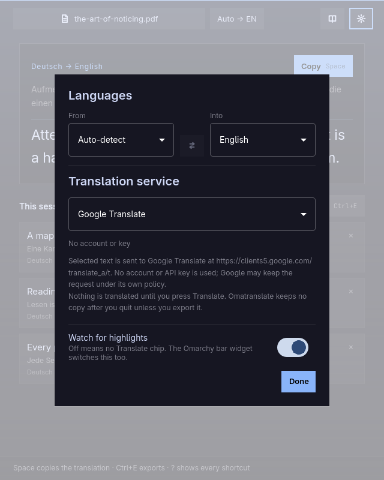

# Translation services

Omatranslate sends one passage at a time to the service you choose in
**Settings** (the gear, or `Ctrl+,`). The sheet always names the exact address
and what is sent there, so nothing about the request is hidden.



## Choosing a service

| Service | Account or key | Endpoint |
| --- | --- | --- |
| **Google Translate** (default) | none | `https://clients5.google.com/translate_a/t` |
| **DeepL** | your API key | `https://api.deepl.com/v2/translate` |
| **DeepL Free** | a key ending in `:fx` | `https://api-free.deepl.com/v2/translate` |
| **LibreTranslate** | optional | the server you name; `/translate` is appended to a bare host |

Changing the service takes effect immediately, for both the window and the
`omatranslate translate` command. There is no per-request flag to override it,
so a script and the window never disagree about where text is going.

### Google Translate

Google's public `translate_a` hosts answer this kind of client with an
anti-bot page, so Omatranslate uses `clients5.google.com`, the host Google's
own browser extension calls. It needs no account or key.

This is an unofficial endpoint. It can occasionally answer with an empty
translation; the window and the card then offer **Retry**. If that becomes a
problem, DeepL or a self-hosted LibreTranslate is the dependable choice.

### DeepL

Paste an API key in Settings. Free-tier keys end in `:fx` and automatically
use `api-free.deepl.com`; all other keys use the paid host. DeepL's language
set is smaller than Google's, and Omatranslate maps its codes to the ones DeepL
expects.

DeepL is the only provider that receives your key with every request. It is
stored in `~/.config/omatranslate/omatranslate.ini` (`0600`).

### LibreTranslate

Give the address of a LibreTranslate server. A bare host such as
`http://localhost:5000` becomes `http://localhost:5000/translate`; a full path
is used as typed. An API key is optional and is sent as `api_key` only when
you provide one.

A local server keeps the text on your machine:

```sh
docker run -d --name libretranslate -p 5000:5000 \
  libretranslate/libretranslate
```

Then set the server to `http://localhost:5000` in Settings. The public
`https://libretranslate.com` works too, but may require a key and rate-limits
anonymous use.

## What is sent

For every translation, Omatranslate sends:

- the highlighted passage;
- the source language (`auto` when detecting) and the target language;
- for DeepL and LibreTranslate, your API key.

It does **not** send the PDF, its name, the page number, your history, or any
machine or account identifier. A very long passage is split into chunks and
sent in order; each chunk contains only its part of the text.

Nothing is sent when you highlight, open a document, or switch languages. The
request happens only when you press **Translate**, click the chip, press
`Enter`, or run `omatranslate translate`.

## What is kept

- Translations live in memory for the current session.
- Nothing is written to disk unless you export (Markdown beside the PDF).
- The service choice, language pair, keys, and last folders are saved in
  `~/.config/omatranslate/omatranslate.ini`.

The service's own retention policy applies to what it receives; Google, DeepL,
and any LibreTranslate operator each have their own. Omatranslate cannot
change that, which is why the endpoint is shown before you choose.

## Settings file

The file is plain INI, created readable only by you (`0600`):

```ini
[General]
provider=deepl
deeplApiKey=xxxxxxxx-xxxx-xxxx-xxxx-xxxxxxxxxxxx:fx
libreUrl=http://localhost:5000
libreApiKey=
sourceLanguage=auto
targetLanguage=en
enabled=true
folder=/home/you/Documents
exportFolder=/home/you/Documents
```

| Key | Meaning |
| --- | --- |
| `provider` | `google`, `deepl`, or `libretranslate` |
| `deeplApiKey` | DeepL key; `:fx` selects the free host |
| `libreUrl` | LibreTranslate server address |
| `libreApiKey` | optional LibreTranslate key |
| `sourceLanguage` | `auto` or a language code |
| `targetLanguage` | language code |
| `enabled` | whether the watcher runs when the service starts |
| `folder` | last folder used by **Open** |
| `exportFolder` | last folder used by **Export** |

Edit the file only while Omatranslate is stopped: the running app writes the
whole file when a setting changes and would overwrite your edit.
