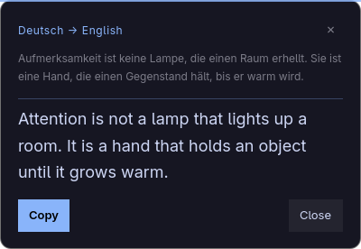
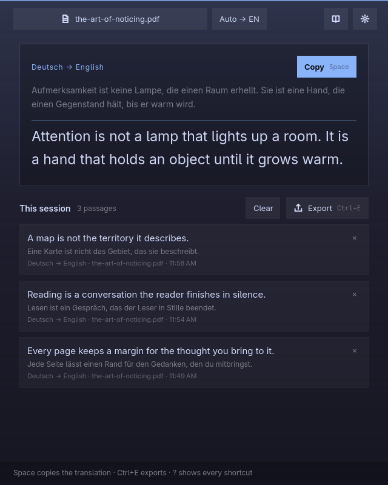

# Reading and the session

Omatranslate is a companion, not a reader. It never draws the PDF itself: it
opens the file in your own reader and watches what you highlight there.

## Opening a PDF

Three ways, all equivalent:

- `omatranslate open paper.pdf` — opens the file in your default reader and
  shows the Omatranslate window.
- **Open with → Omatranslate** in your file manager. The app appears in that
  menu after installation but does not become the default handler.
- `Ctrl+O` inside Omatranslate — the system file picker; the folder you choose
  is remembered for next time.

Opening a PDF this way also starts the background service if it is not already
running. There is never a second copy watching the selection.

## The Translate chip

While the service is **Watching**, Omatranslate polls the Wayland primary
selection (the text a highlight puts on the clipboard) every half second. When
the selection changes, a small chip appears at the end of it:

```
┌────────────┐
│ Aa Translate │
└────────────┘
```

Click it, and only then is the passage sent to the translation service. The
chip is deliberately the only automatic part: highlighting a passage in your
reader does not translate it, and nothing is sent until you press the chip or
`Enter` in the Omatranslate window.

The chip stays visible while the selection remains active, including when you
move the pointer over it. It disappears when the selection is cleared or
watching is disabled. `Enter` in the Omatranslate window also translates the
current selection.

The chip needs `wl-clipboard`. If it is missing, the app says so instead of
silently watching nothing.

## The translation card



The card shows:

- the language pair, such as `Deutsch → English`;
- the passage you selected, dimmed;
- the translation, large enough to read;
- **Copy** (or `Space`) and **Close** (or `Esc`).

It sits where the highlight ended rather than scrolling with the page, and is
positioned next to it using Hyprland's monitor, pointer, and active-window
information. On a multi-monitor
setup it picks the screen the highlight is on and stays inside its bounds. If
Hyprland is not available, or the highlight cannot be placed, the translation
still appears in the Omatranslate window — only the floating card is lost.

The card closes on **Close**, on `Esc`, when you start another highlight, or
when the selection is cleared. Closing the card does not remove the
translation from the session.

## The session window

Every translation is added to the session list, newest first. Each row keeps:

- the translated text and the original passage;
- the language pair and the time;
- the document name, when a PDF is open.

Translating the same passage into the same language again moves it to the top
instead of duplicating it. The session holds up to 300 passages.



The window is also where you read without a card, copy a row, remove a row, or
export. `Ctrl+Z` puts back rows you removed. **Clear** empties the session
after asking, and `Ctrl+Z` can undo that too.

### Closing the window

In normal use Omatranslate runs as a background service, and the window is only
a view onto it. Closing the window — the title-bar button, `Q`, or
`omatranslate hide` — hides it and keeps watching and the session alive.

To end the process, use **Stopped** in the bar widget, or `omatranslate stop`.
If the session still has translations you have not exported, `stop` keeps the
window open and says so, so you can export first. `omatranslate quit` always
exits, discarding the session.

## Exporting

`Ctrl+E`, the **Export** button, or `omatranslate`'s file picker writes a
sidecar Markdown file:

```
paper.omatranslate.md
```

next to the PDF (or `omatranslate.md` when no document is open). The system
save dialog lets you choose another place; the folder you pick is remembered.
The original PDF is never written to.

The file reads oldest first, so it follows the document:

```markdown
# Translations

- **Document:** paper.pdf
- **Exported:** 2026-11-02 18:40

## 1 · German → English · 18:32

> Aufmerksamkeit ist keine Lampe, die einen Raum erhellt.

Attention is not a lamp that lights up a room.
```

Nothing is written until you export, and quitting does not keep a copy. That
is why `stop` refuses to end a session that has not been exported yet.

## Keyboard

| Key | What it does |
| --- | --- |
| `Ctrl+O` | Open a PDF in your reader |
| `Space` | Copy the translation |
| `Enter` | Translate the passage now |
| `Ctrl+E` | Export the session as Markdown |
| `Ctrl+Z` | Undo removing translations |
| `Ctrl+,` | Open Settings |
| `?` | Show every shortcut |
| `Q` | Hide the window (the service keeps running) |
| `Esc` | Close the shortcut list or the card |

In the bar widget: arrows or `h` `j` `k` `l` move the cursor, `Enter` activates,
`s` starts or stops watching, `o` opens the app, and `,` opens Settings.

## What is remembered

| Where | What |
| --- | --- |
| `~/.config/omatranslate/omatranslate.ini` | Language pair, service, keys, last folders, whether to watch at login |
| `~/.config/omarchy/shell.json` | The widget's bar entry and its `enabled` flag |
| Memory only | The translations of the current session |

The ini file is created `0600` because it can hold an API key.
